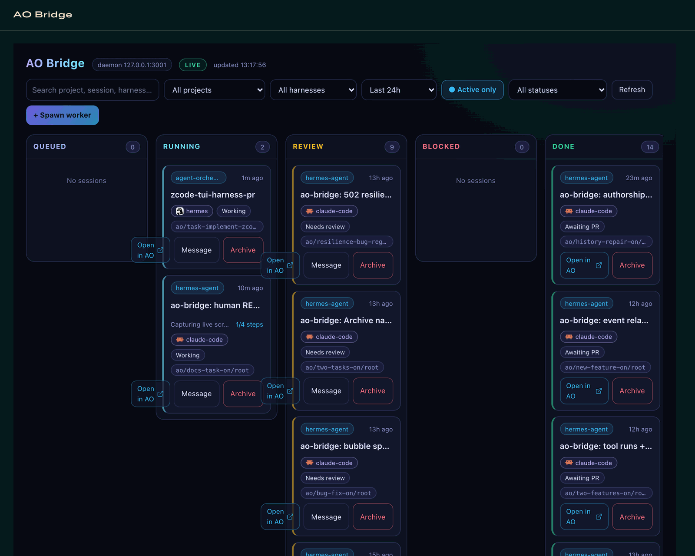
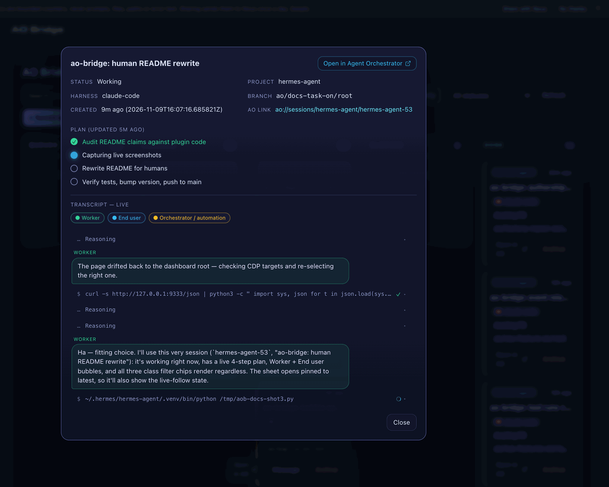
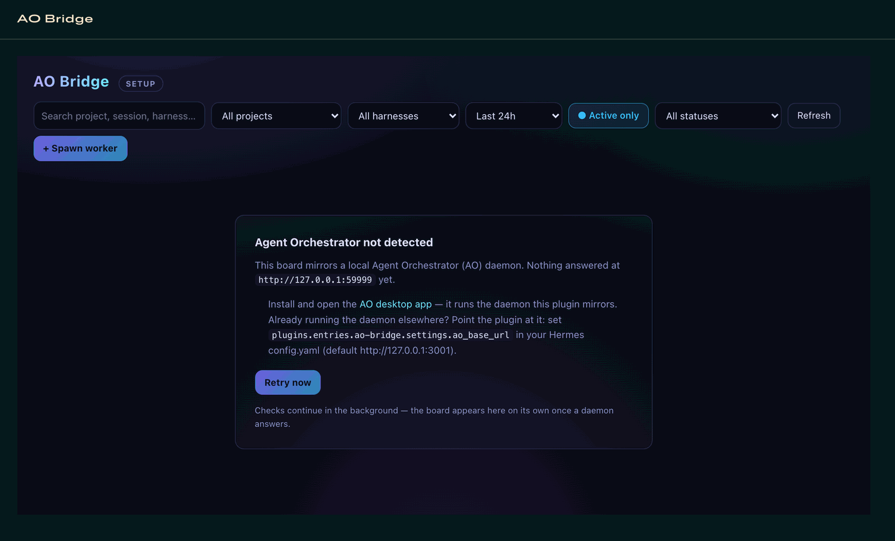

# ao-bridge — an Agent Orchestrator board in the Hermes dashboard

ao-bridge is a [Hermes](https://github.com/NousResearch/hermes-agent) dashboard
plugin that turns the local [Agent Orchestrator (AO)](https://github.com/OrchestratorInc/agent-orchestrator)
daemon into a live Kanban board: every AO project's sessions render as cards
across six columns, you can spawn new workers, message running ones, open a
session's transcript as a chat, and jump into the AO desktop app from any card.
The plugin runs nothing itself — it mirrors the daemon, which does the actual
agent work.



## Requirements

- **Hermes** with the web dashboard and its plugin SDK (current releases ship both).
- **The AO desktop app** (or a standalone `ao` daemon) running on the same
  machine — the plugin talks only to its loopback REST API, `http://127.0.0.1:3001`
  by default. Launching the AO app starts the daemon.

## Install

```bash
hermes plugins install <path-or-repo>   # or copy this directory into ~/.hermes/plugins/
hermes plugins enable ao-bridge         # user plugins are opt-in by design
```

Then **restart the dashboard**: the plugin's backend imports once at dashboard
startup, so installs and updates only take effect after a restart (the UI
tells you when it's newer than the running backend — see *Version-skew banner*).
An **AO Bridge** tab appears in the dashboard.

## What you get

**The board.** Columns `Queued · Running · Review · Blocked · Done · Archive`,
mapped from live AO session state (exact rules below). Cards show project,
session name, harness icon, status, branch, age, and PR links, and working
cards show the worker's current plan step. Spawn workers with the **+ Spawn
worker** form (project, harness, name, initial prompt), send messages to live
sessions, and archive sessions (with confirmation — archiving terminates the
session via the daemon).

| AO session state | Board column |
|---|---|
| `isTerminated` / status `terminated` | Archive |
| status `merged` | Done |
| status `review_pending` or `kanbanColumn: needs_review` | Review |
| status `ci_failed` or `provisionState: failed` | Blocked |
| `provisionState: provisioning` | Queued |
| `kanbanColumn: ready`, or displayStatus `Awaiting PR` | Done |
| `working` / `idle` / `exited` (session alive) | Running |

**Filters.** Text search over project, session name and harness; dropdown
filters for status, project and harness; a recency selector (last hour / 24h /
7 days / all time, default 24h); and an **Active only** toggle (default on)
that hides terminated, exited and archived sessions. All filtering happens in
the browser over the already-fetched board, and the filtered view still
updates live. Recency, the active toggle, and the Archive column's
collapse state persist across reloads.

**Live updates.** A WebSocket stream pushes board changes the moment the
daemon state moves (the backend re-checks AO about twice a second and only
sends real diffs) — no manual refresh. If the stream can't run, the board
falls back to 5-second polling; a `live` / `polling` / `degraded` badge shows
which mode you're in.

**Card detail.** Click a card for the session's metadata, its live plan, and
the conversation transcript as an iMessage-style chat, color-coded by sender
class: **Worker** turns (the agent's output), **End user** messages (typed in
the AO app), and **Orchestrator / automation** (everything injected over the
REST API — including messages sent from this board). Each class has a
click-to-hide filter chip, and classification keys on the daemon's `origin`
field — the `userAuthored` flag senders pass is self-declared and is never
treated as proof of human authorship. The sheet opens at the latest message
and follows new ones while open (~1s); scrolling up unpins and shows a
**↓ Jump to latest** pill. The transcript tail is bounded to the last 200
messages.



**Tool runs and plans.** The daemon's command, MCP-tool and reasoning
activities interleave with messages in order, kept visually quiet: one muted
line per execution with an exit glyph (✓ / ✗ / spinner), click to expand the
full command, input or output (outputs capped at 4,000 characters, last 400
activities). The worker's plan renders as a checklist in the sheet and as a
one-line "current step" on working cards.

**Open in Agent Orchestrator.** Every card and the detail sheet carry the
canonical `ao://sessions/{projectId}/{sessionId}` deep link, handing off to
the AO desktop app. The app must have registered the `ao` URL scheme — some
nightlies register only `ao-app`, in which case the link won't resolve.

**Daemon-outage resilience.** When the AO daemon goes down, the board keeps
the last-known state under an "AO daemon unreachable — retrying…" banner with
a `degraded` badge, every failure surfaces as a typed error (never a blank
board), and live mode resumes automatically — including a forced refresh the
moment the daemon is back, even if nothing changed.

**Version-skew banner.** The dashboard imports the plugin's backend once at
startup while the frontend is served fresh from disk, so an updated plugin can
end up driving a stale backend. The UI compares versions and shows a "Plugin
updated — reload dashboard to apply" banner with a **Reload** button instead of
misbehaving silently.

**First-run setup.** If the daemon has never answered, the board shows a setup
panel — what to install, how to point the plugin at a daemon elsewhere — with
a retry button, and checks continue in the background. Once connected, later
outages get the retry banner instead of regressing to setup.



**Per-harness icons.** Cards and the spawn form show the same icon per harness
that the AO desktop app shows (38 harnesses mapped, with a fallback icon).

## Configuration

Settings live at `plugins.entries.ao-bridge.settings.*` in `~/.hermes/config.yaml`:

```yaml
plugins:
  entries:
    ao-bridge:
      settings:
        ao_base_url: http://127.0.0.1:3001
        relay_enabled: false
```

| Key | Default | What it does |
|---|---|---|
| `ao_base_url` | `http://127.0.0.1:3001` | Base URL of the AO daemon's REST API. Loopback only. |
| `relay_enabled` | `false` | Turn on the AO event relay (see below). |
| `relay_events` | `[]` (all) | Which event kinds to relay: `report_done`, `report_checkpoint`, `report_stuck`, `report_needs_input`, `session_idle`, `session_exited`, `session_terminated`. |
| `relay_api_url` | `http://127.0.0.1:8642` | Gateway api_server base URL the relay delivers through (loopback). Relay only. |
| `relay_peer` | *(empty)* | Name of a Hermes peer whose `HERMES_PEER_<NAME>_KEY` authenticates relay delivery; falls back to `API_SERVER_KEY` when unset. Relay only. |
| `relay_session` | *(empty)* | Override destination for events whose orchestrator mapping can't resolve (see the relay section). Normal destinations are resolved per event; `GET /api/plugins/ao-bridge/relay/sessions` lists recent sessions to copy from. Relay only. |

For development, `AO_BRIDGE_BASE_URL` overrides the daemon URL (the config
setting wins when both are set). The backend reads nothing beyond the table
above; the relay's delivery credential comes from Hermes's secret store, not
from plugin config.

## AO event relay (opt-in)

With `relay_enabled: true`, the plugin's backend (not your browser) polls the
AO daemon and delivers worker milestones — report transitions (done /
checkpoint / stuck / needs-input) and working → idle / exited / terminated
changes — into the owning orchestrator's Hermes conversation, so they reach
you wherever that conversation lives, not only in the AO app.

**Where events go.** Destinations are resolved per event from AO's own
structure: the event's project's live orchestrator session (AO REST), then the
Hermes conversation that orchestrator runs (identified by its
`…/worktrees/<project>/orchestrator/` working-directory marker — not the
volatile display name). Workers on different projects route to their own
orchestrators. Events that can't be mapped — no live orchestrator, several
sharing a project, no matching conversation — are dropped rather than guessed
(and reported via the diagnostics endpoint); `relay_session` is an explicit
override for exactly those cases.

**How it delivers.** The batch is submitted as a **live turn** to the
destination session through the gateway's own api_server session-chat route —
the same path `hermes peer dm` drives. A delivered event **wakes the
destination session immediately and costs it a model turn**: the agent sees
the milestone right away and may act on it — that's the point. Milestones
landing within ~5 seconds share one turn (max 8 lines), so the cost is per
burst, not per event; the `relay_events` filter keeps quiet projects quiet.
The relay needs the gateway's api_server reachable (loopback by default) and
a Hermes-held credential: set `relay_peer` to a peer name (its
`HERMES_PEER_<NAME>_KEY` is used, scoped like `hermes peer` resolves it) or
let it fall back to `API_SERVER_KEY`.

The relay deduplicates on stable report ids (AO's repeat-count churn never
re-relays the same state), records a baseline on its first poll so enabling it
doesn't flood any conversation with history, stays silent through daemon
downtime, and retries when the gateway is busy or unreachable (permanent
failures — no credential, gone session — drop the batch and surface in
diagnostics). `GET /api/plugins/ao-bridge/relay` reports enabled state,
credential source, pending destinations, delivered count and last error. It
makes no platform sends: the conversation's own bound surfaces render the
exchange, exactly as for any turn in it.

## Security & privacy

| Capability | What actually happens |
|---|---|
| **Spawns agent sessions** | `POST …/spawn` creates a real AO worker session (an AI coding agent) that executes tasks in that project's workspace. |
| **Archives agent sessions** | The card's Archive action calls the daemon's kill endpoint, terminating a running session. Unsaved work in its workspace is lost. |
| **Messages agents** | The Message action posts into a running session; the agent treats it as user input and acts on it. |
| **Reads AO state** | The board, detail sheet and relay read the daemon's project/session/report endpoints. Read-only. |
| **Relays AO events (opt-in)** | With `relay_enabled`, the backend submits worker milestones as live turns to the destination session through the gateway's api_server session-chat route (`relay_api_url`, loopback by default). A delivered event wakes that session. Authenticated with a Hermes-held key (`HERMES_PEER_<NAME>_KEY` or `API_SERVER_KEY`) — the plugin config holds no secrets. |

All network calls go to the local AO daemon on loopback — plus, when the
relay is enabled, the local gateway api_server it delivers through. The
plugin's config holds no secrets; the relay's credential is read from
Hermes's own secret store through the same scoped mechanism `hermes peer`
uses. Plugin API routes sit behind the dashboard's auth, so scripts and
agents can't call them headlessly — call the daemon's own loopback REST API
directly instead.

## Known limitations

- **Intra-turn card motion is bounded by the daemon.** A session's row is
  static for the length of a turn, so a working card's plan step refreshes on
  a 15-second cache while the turn runs; the detail sheet's watch channel is
  the fine-grained (~1s) live surface for a single session.
- **No drag-and-drop between columns** — column membership is AO-owned state,
  and the plugin doesn't fight the daemon's lifecycle model.
- **Spawn requires a healthy workspace registration** — AO itself rejects
  spawns for projects whose directories are missing.

## Development

```
hermes-ao-bridge/
├── plugin.yaml               # package manifest + config_schema
├── __init__.py               # register(ctx) — no agent-runtime registrations
└── dashboard/
    ├── manifest.json         # tab (/ao-bridge, after skills) + api + assets
    ├── plugin_api.py         # FastAPI router, mounted at /api/plugins/ao-bridge/
    ├── assets/               # per-harness icons + map (served to the browser)
    └── dist/                 # plain-IIFE React frontend (HERMES_PLUGIN_SDK) + theme CSS
```

The backend is stdlib + FastAPI only, importable outside the dashboard server
(the `hermes_cli` config read is best-effort inside functions). It talks to
the AO daemon with `urllib`:

| Plugin route (`/api/plugins/ao-bridge/`) | AO daemon call |
|---|---|
| `GET /health`, `GET /board` | `GET /healthz`; `GET /api/v1/projects` + `GET /api/v1/sessions` (+ `GET /api/v1/sessions/{id}/conversation` for plan steps) |
| `GET /sessions/{id}/detail` | `GET /api/v1/sessions/{id}` + `…/conversation` |
| `POST /spawn` | `POST /api/v1/sessions` (kind `worker`) |
| `POST /sessions/{id}/send` | `POST /api/v1/sessions/{id}/send` |
| `POST /sessions/{id}/kill` | `POST /api/v1/sessions/{id}/kill` |
| `GET /relay`, `GET /relay/sessions` | `GET /api/v1/reports?projectId=…` (relay only) |
| `WS /events` | board + detail pushes; server-polls the routes above |

**Tests** run against an in-process fake AO daemon — no live daemon, no
network, stdlib `unittest` only:

```bash
~/.hermes/hermes-agent/.venv/bin/python -m unittest discover -s tests -t tests
```

(Any Python with `fastapi` works; the suite isolates `HERMES_HOME` to a
throwaway directory.) Coverage: the AO client, column mapping, the FastAPI
router (board assembly, spawn/send/kill, error mapping, detail shape and
bounding, WebSocket stream, outage recovery, version-skew binding), plan
parsing, and the relay (event extraction, batching, dedup, delivery).

**Serving locally:** point a throwaway Hermes home at this checkout to verify
frontend/backend changes against a live daemon — assets are served per-request
from disk (frontend edits are live on reload), while `plugin_api.py` imports
once at dashboard boot (restart the dashboard to pick up backend edits):

```bash
HERMES_HOME=/tmp/ao-bridge-dev-home hermes dashboard --port 9119 --no-open
# with /tmp/ao-bridge-dev-home/config.yaml:
#   plugins:
#     enabled: [ao-bridge]
# and this checkout at /tmp/ao-bridge-dev-home/plugins/ao-bridge
```
