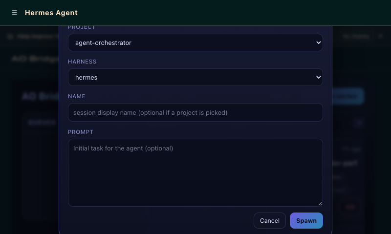
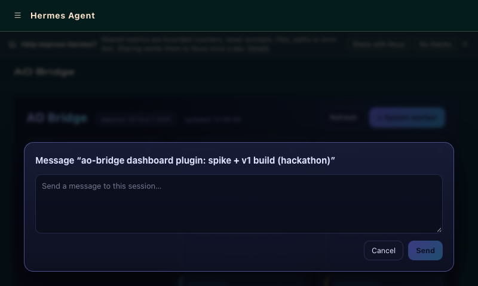

# ao-bridge — Hermes Dashboard Plugin

A Hermes web-dashboard plugin that makes the **Agent Orchestrator (AO) daemon**
Hermes' multi-project orchestration backend, surfaced as a Kanban board.

Every AO project's sessions render as cards across columns mapped from live AO
session state — spawn new workers, send messages to running sessions, watch the
board refresh itself.

## ⚠️ Capability disclosure (read this first)

| Capability | Detail | Risk |
|---|---|---|
| **Spawns agent sessions** | `POST /api/plugins/ao-bridge/spawn` creates a real AO worker session (an AI coding agent) in the selected project with the harness you pick. | **Heavy.** The spawned agent executes tasks in that project's workspace. |
| **Kills agent sessions** | The card **Kill** action calls the AO daemon's kill endpoint, terminating a running agent session. | **Heavy.** Unsaved work in that session's workspace is lost. |
| **Sends messages to agents** | The **Message** action posts a user-authored message into a running AO session; the agent treats it as user input and acts on it. | Medium. Drives a live agent. |
| **Local-only network calls** | The backend talks ONLY to the local AO daemon REST API (`http://127.0.0.1:3001` by default, loopback). No secrets are read, no external requests are made. | Low. Local loopback only. |
| **Reads AO state** | `GET /board` reads the AO daemon's project and session lists and reduces them to board cards. | Low. Read-only. |

Nothing here spawns processes itself, touches the filesystem outside the AO
daemon's own scope, or calls any network host other than the configured local
AO daemon base URL.

## Screenshots

The board against a live AO daemon (six projects, 300+ sessions):


Spawn form — pick a registered project, harness, name, and initial prompt:



Message sheet — send a user-authored message to a running session:



## Requires

- A running **Agent Orchestrator (AO) daemon** on the same machine (default
  `http://127.0.0.1:3001`, configurable via the plugin's `ao_base_url` setting).
- A Hermes version whose dashboard exposes `window.__HERMES_PLUGIN_SDK__`
  (current releases do).

## What you get

- **Kanban board**: columns `Queued · Running · Review · Blocked · Done · Archive`,
  mapped from live AO session state (`provisionState`, `status`, `kanbanColumn`,
  `isTerminated`). Cards show project, session name, harness, display status,
  branch, age, and PR links.
- **Live updates**: a WebSocket stream (`/events`) pushes board changes the
  moment the daemon state moves (server polls AO at ~1s, hash-gated diffs) —
  no manual refresh. Falls back to 5s polling automatically; a `live`/`polling`
  badge shows which mode you're in.
- **Search & filter**: instant client-side match on project, session name, and
  harness, plus a status dropdown built from live `displayStatus` values.
- **Card detail sheet**: click a card for status, project, harness, branch,
  age, the transcript tail (bounded to 200 messages), and the canonical
  `ao://sessions/…` link — read-only.
- **Spawn form**: pick a registered AO project, harness, session name, and
  initial prompt → creates the worker via the AO daemon.
- **Message sheet**: send a user-authored message to any live session.
- **Kill action** with confirmation on any non-archived session.

## Install

```bash
hermes plugins install <path-or-repo>   # or copy this dir into ~/.hermes/plugins/
hermes plugins enable ao-bridge         # user plugins are opt-in by design
```

Then open the dashboard — a new **AO Bridge** tab appears after Skills.

Requires a running AO daemon (the Agent Orchestrator desktop app or
`ao` daemon) on the loopback. Default base URL: `http://127.0.0.1:3001`.

### Configuration

`plugin.yaml` declares one setting (`config_schema`), stored at
`plugins.entries.ao-bridge.settings.ao_base_url` in config.yaml:

```yaml
plugins:
  entries:
    ao-bridge:
      settings:
        ao_base_url: http://127.0.0.1:3001
```

For development you can also set `AO_BRIDGE_BASE_URL` (the config.yaml setting
wins when both are present). The backend reads no other configuration and
no secrets.

## How it differs

Almost nothing ships an **agent runtime as the orchestrator brain over many
external harnesses** — the one exception stops at chat tools (below). The
landscape splits into five groups, and ao-bridge sits in the gap between them:

| Category | Projects | Why it's not this |
|---|---|---|
| Hermes-native orchestration | Hermes built-in kanban & delegation, olympus, hermes-war-room | Orchestrate **Hermes profiles only** — no claude-code/codex/agy workers underneath |
| Multi-harness orchestrators with Hermes as a worker | mco, awslabs cli-agent-orchestrator, Agentainer, bernstein | Hermes is **one CLI they drive** — Hermes never drives the fleet |
| Standalone fleet apps, human-conducted | Paseo, agetor, Hydra, multiagents | The **human is the conductor**; no agent runtime sits in the loop |
| Agent-driven via CLI skill | **Orca** (stablyai/orca) | See below — closest, but the agent only reaches it by shelling out |
| Agent tools for AO, chat-only | **hermes-ao** (illegalcall/hermes-plugin-agent-orchestrator, by the AO vendor) | Real: 17 agent tools (spawn/send/kill/issues/PRs) so Hermes can conduct AO from chat. But it has **no UI** — the human's only window is chat text — and it shells the `ao` CLI per call (`AO_CWD`, subprocess timeouts) rather than the daemon REST. Last updated April 2026. |

**On hermes-ao:** it proves the demand for Hermes-conducts-AO and deserves credit —
it's the AO vendor's own tool plugin. ao-bridge is the layer it doesn't have:
the **visual board**. Where hermes-ao turns the conversation into the only
interface (text in, text out), ao-bridge gives the human a live window — every
AO project's sessions on one Kanban board with real-time state, PR links, and
one-click spawn/send/kill — served from the dashboard over the daemon's REST
API. The two are complementary (chat tools for the agent, board for the
human), and ao-bridge deliberately talks to the daemon's loopback REST instead
of shelling the CLI, so it works wherever the dashboard works.

**On Orca specifically, honestly:** Orca (YC-backed, open source, macOS/Windows/
Linux + mobile + SSH/cloud) matches or beats AO on harness breadth (30+,
including Hermes itself) and clearly wins on platform reach, with real
structured orchestration (runs, tasks, dispatches, supervised workers). But the
only way an agent drives Orca today is by shelling out through `orca-cli` — the
prompt-or-skill category, not a native integration — and the Hermes↔Orca
connection is one-way telemetry: an orca-status hook plugin reports Hermes
events *to* Orca, and nothing lets Hermes *drive* an Orca fleet. We don't claim
ao-bridge beats Orca generally; it claims a different niche.

**The ao-bridge niche:** Hermes stays the agent you already talk to — chat,
Discord, Telegram, cron — while the Agent Orchestrator supplies the machinery
underneath: git worktree isolation per session, session persistence, a review
system, and a 37-harness catalog. It is a real Hermes plugin (dashboard tab +
backend API router, with the shipped hermes-ao-connector closing the loop so
spawned workers talk back through the gateway), not a skill wrapping someone
else's CLI. The dashboard is the human's window; the agent is the conductor.
The target end-state: one orchestrator, driven from messaging, running
multi-harness workers across multiple projects.

## Architecture

```
hermes-ao-bridge/
├── plugin.yaml               # native package manifest + config_schema
├── __init__.py               # register(ctx) — no agent-runtime registrations
└── dashboard/
    ├── manifest.json         # tab (/ao-bridge, after:skills) + api + assets
    ├── plugin_api.py         # FastAPI APIRouter, mounted at /api/plugins/ao-bridge/
    └── dist/
        ├── index.js          # plain-IIFE React frontend (HERMES_PLUGIN_SDK)
        └── style.css         # nebula/galaxy dark theme, scoped under .ao-bridge
```

The backend is stdlib + FastAPI only. It never imports Hermes internals at
module scope (the `hermes_cli` config read is best-effort inside a function) so
the dashboard server, the plugin validator, and bare-FastAPI test harnesses can
all load it. It talks to the AO daemon with `urllib` over these endpoints
(wire contract verified against the live daemon):

| Plugin route (mounted at `/api/plugins/ao-bridge/`) | AO daemon call |
|---|---|
| `GET /health` | `GET /healthz` |
| `GET /board` | `GET /api/v1/projects` + `GET /api/v1/sessions` |
| `POST /spawn` | `POST /api/v1/sessions` (kind `worker`) |
| `POST /sessions/{id}/send` | `POST /api/v1/sessions/{id}/send` |
| `POST /sessions/{id}/kill` | `POST /api/v1/sessions/{id}/kill` |

The frontend registers through `window.__HERMES_PLUGINS__.register`, fetches via
`SDK.authedFetch` (loopback token header and gated-cookie modes both handled by
the SDK), and bails out silently when the SDK global is absent.

## Column mapping

| AO session state | Board column |
|---|---|
| `isTerminated` / status `terminated` | Archive |
| status `merged` | Done |
| status `review_pending` or `kanbanColumn: needs_review` | Review |
| status `ci_failed` or `provisionState: failed` | Blocked |
| `provisionState: provisioning` | Queued |
| `kanbanColumn: ready` (Awaiting PR) | Done |
| `working` / `idle` / `exited` (session alive) | Running |

## Tests

stdlib `unittest` only (the gateway runtime ships no pytest), against an
in-process fake AO daemon — no live daemon, no network:

```bash
HERMES_SRC=~/.hermes/hermes-agent \
  ~/.hermes/hermes-agent/.venv/bin/python \
  -m unittest discover -s hermes-ao-bridge/tests -t hermes-ao-bridge/tests
```

Coverage: AO client (health, projects, sessions, single-session unwrap, spawn
payload shape, send, kill, conversation, error mapping), column mapping (every
rule + precedence), and the FastAPI router (board assembly, spawn validation,
send/kill forwarding, 502/404/409 mapping, detail route shape + transcript
truncation + 404, WebSocket stream push-on-change / daemon-blip survival /
auth rejection) via `fastapi.testclient`.

## Known limitations

- Poll-based refresh (5 s); AO's WebSocket events are a future polish step.
- Spawn requires the target project's workspace registration to be healthy;
  AO itself rejects spawns for projects with missing directories.
- No drag-and-drop between columns — column membership is AO-owned state, and
  the plugin deliberately doesn't fight the daemon's lifecycle model.
